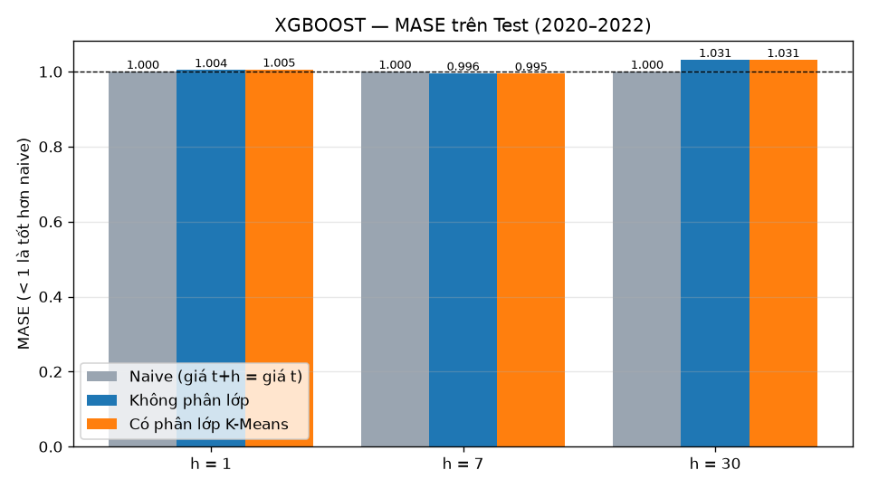
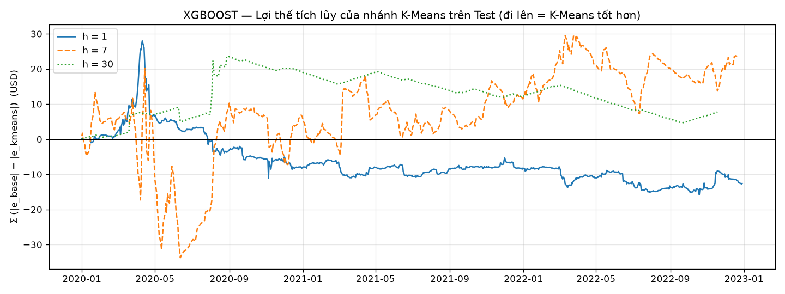
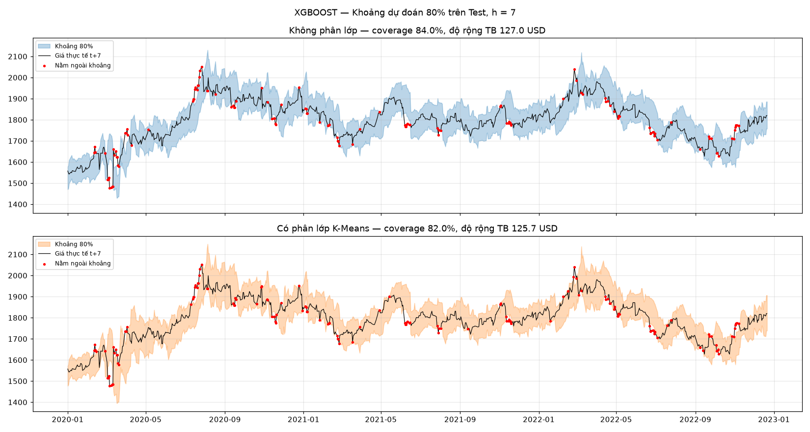
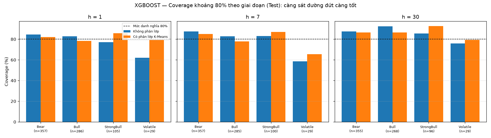
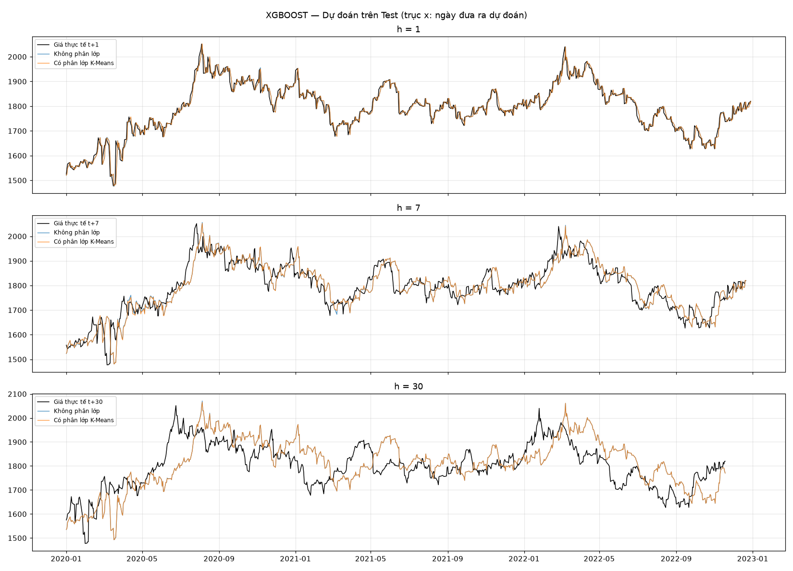
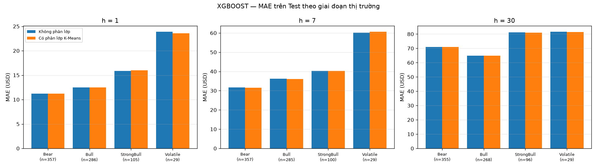

# Kết quả dự đoán — Có phân lớp K-Means vs Không phân lớp

> Sinh tự động bởi `python -m source.model.report_forecast`. Không sửa tay.

## 1. Thiết kế thí nghiệm

- **Câu hỏi:** phân lớp giai đoạn thị trường bằng K-Means trước khi dự đoán có giúp dự đoán giá vàng tốt hơn không?
- **Nhánh không phân lớp (base):** dữ liệu `*_base.csv` → feature riêng của từng model.
- **Nhánh có phân lớp (kmeans):** dữ liệu `*_kmeans.csv` → cùng feature đó + nhãn giai đoạn do `kmeans.joblib` gán (`kmeans_Bear`, `kmeans_Bull`, `kmeans_StrongBull`, `kmeans_Volatile`, `regime_id`).
- Trong cùng một model, hai nhánh dùng **cùng các dòng dữ liệu, cùng feature gốc, cùng target, cùng quy trình tuning** → khác biệt chỉ đến từ thông tin phân lớp.
- Target: log-return h phiên tới; giá dự đoán = giá hôm nay × exp(ŷ). Đánh giá trên giá (USD/oz).
- Tuning: Optuna trên walk-forward folds cuối của Train (có purge theo ngày target). Validation: fit Train + early stopping. Test: refit Train+Val, đánh giá trên 2020–2022.
- **Naive baseline:** giá t+h = giá t. **MASE < 1** nghĩa là tốt hơn naive.
- **Diebold-Mariano (DM):** kiểm định sai số tuyệt đối của 2 nhánh có khác nhau thật không (DM < 0: K-Means sai số nhỏ hơn; có ý nghĩa nếu p < 0.05).

## 2. Tóm tắt kết luận (Test 2020–2022)

1. **Dự đoán điểm (giá):** K-Means tốt hơn có ý nghĩa ở 0/3 khoảng dự đoán, kém hơn ở 0, không khác biệt ở 3; MAE thay đổi trung bình +0.01%. 2/6 cấu hình tốt hơn naive.
2. **Khoảng dự đoán (độ tin cậy):** K-Means tốt hơn có ý nghĩa ở 0/6 cấu hình (h × mức tin cậy), kém hơn ở 0; Winkler score thay đổi trung bình -2.79% (âm = tốt hơn).

## 3. Dự đoán điểm — có phân lớp vs không phân lớp

| model | horizon | MAE_base | MAE_kmeans | ΔMAE_% | MASE_base | MASE_kmeans | DA_base | DA_kmeans | DM_stat | p_value | kết_luận |
|---|---|---|---|---|---|---|---|---|---|---|---|
| xgboost | 1 | 12.7763 | 12.7925 | 0.1269 | 1.0041 | 1.0054 | 45.6885 | 44.6589 | 0.5957 | 0.5515 | Không khác biệt có ý nghĩa |
| xgboost | 7 | 35.5164 | 35.4862 | -0.0852 | 0.9955 | 0.9947 | 55.2529 | 54.2153 | -0.4071 | 0.6841 | Không khác biệt có ý nghĩa |
| xgboost | 30 | 70.5209 | 70.5105 | -0.0147 | 1.0312 | 1.0311 | 48.9305 | 48.9305 | -0.3692 | 0.7121 | Không khác biệt có ý nghĩa |

## 4. Khoảng dự đoán — có phân lớp vs không phân lớp

Hiệu chỉnh trên sai số out-of-fold walk-forward 2004–2017 (đủ mọi giai đoạn), đánh giá trên Test. Nhánh base dùng một độ rộng chung; nhánh kmeans dùng độ rộng theo giai đoạn do K-Means gán. **Coverage** càng sát mức danh nghĩa càng tốt; **Winkler** (độ rộng + phạt khi giá thực nằm ngoài) càng nhỏ càng tốt.

| model | horizon | level_% | coverage_%_base | coverage_%_kmeans | width_usd_base | width_usd_kmeans | winkler_base | winkler_kmeans | Δwinkler_% | DM_winkler | p_value | kết_luận |
|---|---|---|---|---|---|---|---|---|---|---|---|---|
| xgboost | 1 | 80 | 82.111 | 81.081 | 46.347 | 45.172 | 72.715 | 72.289 | -0.586 | -0.636 | 0.525 | Không khác biệt có ý nghĩa |
| xgboost | 1 | 95 | 95.882 | 94.852 | 83.383 | 79.571 | 115.622 | 110.888 | -4.094 | -1.572 | 0.116 | Không khác biệt có ý nghĩa |
| xgboost | 7 | 80 | 84.047 | 81.971 | 126.962 | 125.695 | 174.962 | 172.922 | -1.166 | -0.526 | 0.599 | Không khác biệt có ý nghĩa |
| xgboost | 7 | 95 | 96.368 | 96.239 | 212.672 | 204.483 | 261.391 | 240.884 | -7.845 | -1.383 | 0.167 | Không khác biệt có ý nghĩa |
| xgboost | 30 | 80 | 88.636 | 87.032 | 260.942 | 258.860 | 298.996 | 296.838 | -0.722 | -0.380 | 0.704 | Không khác biệt có ý nghĩa |
| xgboost | 30 | 95 | 99.599 | 99.465 | 460.988 | 450.122 | 463.324 | 452.605 | -2.314 | -0.742 | 0.458 | Không khác biệt có ý nghĩa |

### Coverage và độ rộng theo giai đoạn

| model | horizon | level_% | regime | n | coverage_%_base | coverage_%_kmeans | width_usd_base | width_usd_kmeans |
|---|---|---|---|---|---|---|---|---|
| xgboost | 1 | 80 | Bear | 357 | 84.59 | 82.07 | 46.10 | 42.80 |
| xgboost | 1 | 80 | Bull | 286 | 82.87 | 78.32 | 46.54 | 38.75 |
| xgboost | 1 | 80 | StrongBull | 105 | 77.14 | 85.71 | 47.75 | 63.91 |
| xgboost | 1 | 80 | Volatile | 29 | 62.07 | 79.31 | 42.51 | 69.77 |
| xgboost | 1 | 95 | Bear | 357 | 97.20 | 95.80 | 82.93 | 73.13 |
| xgboost | 1 | 95 | Bull | 286 | 96.85 | 93.36 | 83.72 | 69.74 |
| xgboost | 1 | 95 | StrongBull | 105 | 93.33 | 96.19 | 85.90 | 114.81 |
| xgboost | 1 | 95 | Volatile | 29 | 79.31 | 93.10 | 76.48 | 128.23 |
| xgboost | 7 | 80 | Bear | 357 | 87.39 | 85.15 | 126.28 | 118.45 |
| xgboost | 7 | 80 | Bull | 285 | 82.81 | 77.89 | 127.47 | 111.88 |
| xgboost | 7 | 80 | StrongBull | 100 | 83.00 | 87.00 | 130.98 | 170.62 |
| xgboost | 7 | 80 | Volatile | 29 | 58.62 | 65.52 | 116.55 | 195.74 |
| xgboost | 7 | 95 | Bear | 357 | 99.72 | 97.48 | 211.52 | 187.61 |
| xgboost | 7 | 95 | Bull | 285 | 96.84 | 95.44 | 213.53 | 183.81 |
| xgboost | 7 | 95 | StrongBull | 100 | 91.00 | 93.00 | 219.40 | 273.34 |
| xgboost | 7 | 95 | Volatile | 29 | 68.97 | 100.00 | 195.24 | 377.91 |
| xgboost | 30 | 80 | Bear | 355 | 87.61 | 86.48 | 259.50 | 251.33 |
| xgboost | 30 | 80 | Bull | 268 | 92.54 | 86.57 | 262.14 | 229.90 |
| xgboost | 30 | 80 | StrongBull | 96 | 85.42 | 92.71 | 269.40 | 344.17 |
| xgboost | 30 | 80 | Volatile | 29 | 75.86 | 79.31 | 239.54 | 336.27 |
| xgboost | 30 | 95 | Bear | 355 | 100.00 | 100.00 | 458.44 | 439.06 |
| xgboost | 30 | 95 | Bull | 268 | 100.00 | 98.51 | 463.11 | 381.09 |
| xgboost | 30 | 95 | StrongBull | 96 | 97.92 | 100.00 | 475.93 | 633.81 |
| xgboost | 30 | 95 | Volatile | 29 | 96.55 | 100.00 | 423.18 | 615.39 |

- Giai đoạn **Volatile** (khoảng 80%): coverage base trung bình 65.5% → kmeans 74.7%; độ rộng 132.9 → 200.6 USD.
- Giai đoạn **Bull** (khoảng 80%): coverage base 86.1% → kmeans 80.9%; độ rộng 145.4 → 126.8 USD.

## 5. Chi tiết chỉ số dự đoán điểm trên Test

MAE, RMSE: USD/oz · MAPE: % · DA: % dự đoán đúng chiều tăng/giảm.

| model | branch | horizon | MAE | RMSE | MAPE | R2 | MASE | DA | n |
|---|---|---|---|---|---|---|---|---|---|
| naive | Naive (giá t+h = giá t) | 1 | 12.7236 | 19.8206 | 0.7119 | 0.9614 | 1.0000 |  | 777 |
| xgboost | Không phân lớp | 1 | 12.7763 | 19.8307 | 0.7152 | 0.9613 | 1.0041 | 45.6885 | 777 |
| xgboost | Có phân lớp K-Means | 1 | 12.7925 | 19.8403 | 0.7159 | 0.9613 | 1.0054 | 44.6589 | 777 |
| naive | Naive (giá t+h = giá t) | 7 | 35.6765 | 47.3957 | 2.0022 | 0.7709 | 1.0000 |  | 771 |
| xgboost | Không phân lớp | 7 | 35.5164 | 47.4595 | 1.9950 | 0.7703 | 0.9955 | 55.2529 | 771 |
| xgboost | Có phân lớp K-Means | 7 | 35.4862 | 47.4482 | 1.9936 | 0.7704 | 0.9947 | 54.2153 | 771 |
| naive | Naive (giá t+h = giá t) | 30 | 68.3852 | 84.7256 | 3.7887 | 0.1488 | 1.0000 |  | 748 |
| xgboost | Không phân lớp | 30 | 70.5209 | 85.3577 | 3.9169 | 0.1360 | 1.0312 | 48.9305 | 748 |
| xgboost | Có phân lớp K-Means | 30 | 70.5105 | 85.3374 | 3.9164 | 0.1364 | 1.0311 | 48.9305 | 748 |

## 6. Dự đoán điểm theo từng giai đoạn thị trường (Test)

Cho biết phân lớp giúp/hại ở giai đoạn nào.

| model | horizon | regime | nhãn | n | MAE_base | MAE_kmeans | ΔMAE_% |
|---|---|---|---|---|---|---|---|
| xgboost | 1 | Bear | Giảm | 357.000 | 11.191 | 11.203 | 0.113 |
| xgboost | 1 | Bull | Tăng | 286.000 | 12.493 | 12.512 | 0.151 |
| xgboost | 1 | StrongBull | Tăng mạnh | 105.000 | 15.868 | 15.985 | 0.736 |
| xgboost | 1 | Volatile | Biến động mạnh | 29.000 | 23.894 | 23.563 | -1.386 |
| xgboost | 7 | Bear | Giảm | 357.000 | 31.631 | 31.605 | -0.082 |
| xgboost | 7 | Bull | Tăng | 285.000 | 36.233 | 36.132 | -0.278 |
| xgboost | 7 | StrongBull | Tăng mạnh | 100.000 | 40.193 | 40.204 | 0.029 |
| xgboost | 7 | Volatile | Biến động mạnh | 29.000 | 60.178 | 60.643 | 0.772 |
| xgboost | 30 | Bear | Giảm | 355.000 | 71.003 | 71.020 | 0.024 |
| xgboost | 30 | Bull | Tăng | 268.000 | 64.879 | 64.871 | -0.013 |
| xgboost | 30 | StrongBull | Tăng mạnh | 96.000 | 81.132 | 81.071 | -0.076 |
| xgboost | 30 | Volatile | Biến động mạnh | 29.000 | 81.632 | 81.436 | -0.240 |

## 7. Model có dùng thông tin phân lớp không? (Feature importance, nhánh kmeans)

| model | horizon | n_features | tổng_gain_regime_% | rank_tốt_nhất | feature_regime_mạnh_nhất |
|---|---|---|---|---|---|
| xgboost | 1 | 77 | 0.00 | 73 | kmeans_Bear |
| xgboost | 7 | 77 | 0.00 | 73 | kmeans_Bear |
| xgboost | 30 | 77 | 0.00 | 73 | kmeans_Bear |

## 8. Dự đoán điểm trên Validation (2018–2019)

| model | horizon | MAE_base | MAE_kmeans | ΔMAE_% | MASE_base | MASE_kmeans | DA_base | DA_kmeans | DM_stat | p_value | kết_luận |
|---|---|---|---|---|---|---|---|---|---|---|---|
| xgboost | 1 | 6.0067 | 6.0231 | 0.2727 | 1.0100 | 1.0128 | 43.1862 | 43.5701 | 0.9207 | 0.3576 | Không khác biệt có ý nghĩa |
| xgboost | 7 | 16.4454 | 16.4424 | -0.0183 | 0.9858 | 0.9856 | 58.0583 | 58.0583 | -0.0759 | 0.9395 | Không khác biệt có ý nghĩa |
| xgboost | 30 | 39.8937 | 39.8499 | -0.1098 | 1.0502 | 1.0490 | 49.5935 | 49.5935 | -0.7773 | 0.4374 | Không khác biệt có ý nghĩa |

| model | branch | horizon | MAE | RMSE | MAPE | R2 | MASE | DA | n |
|---|---|---|---|---|---|---|---|---|---|
| naive | Naive (giá t+h = giá t) | 1 | 5.9470 | 8.9458 | 0.4438 | 0.9917 | 1.0000 |  | 521 |
| xgboost | Không phân lớp | 1 | 6.0067 | 8.9137 | 0.4483 | 0.9918 | 1.0100 | 43.1862 | 521 |
| xgboost | Có phân lớp K-Means | 1 | 6.0231 | 8.9249 | 0.4495 | 0.9918 | 1.0128 | 43.5701 | 521 |
| naive | Naive (giá t+h = giá t) | 7 | 16.6827 | 22.1328 | 1.2450 | 0.9499 | 1.0000 |  | 515 |
| xgboost | Không phân lớp | 7 | 16.4454 | 21.9993 | 1.2303 | 0.9505 | 0.9858 | 58.0583 | 515 |
| xgboost | Có phân lớp K-Means | 7 | 16.4424 | 21.9946 | 1.2304 | 0.9506 | 0.9856 | 58.0583 | 515 |
| naive | Naive (giá t+h = giá t) | 30 | 37.9870 | 48.6092 | 2.8204 | 0.7691 | 1.0000 |  | 492 |
| xgboost | Không phân lớp | 30 | 39.8937 | 48.1965 | 2.9780 | 0.7730 | 1.0502 | 49.5935 | 492 |
| xgboost | Có phân lớp K-Means | 30 | 39.8499 | 48.1697 | 2.9752 | 0.7733 | 1.0490 | 49.5935 | 492 |

## 9. Ghi chú khi đọc kết quả

- R² trên giá luôn cao vì giá hôm nay đã giải thích gần hết giá ngày mai; hãy so MASE và DA với naive.
- Dự đoán giá vàng ngắn hạn gần như bước ngẫu nhiên: MASE quanh 1 và DA quanh 50% là bình thường. Điểm cần đọc là **chênh lệch giữa 2 nhánh** và **kiểm định DM**.
- Val không có giai đoạn Volatile (xem `results/kmeans/result_k_mean.md`), nên Test là căn cứ chính.
