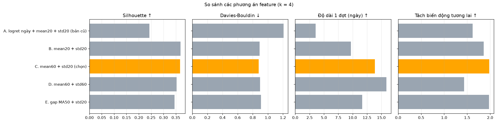
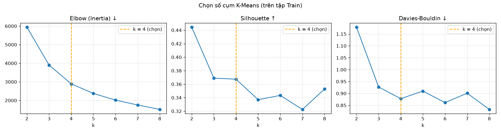
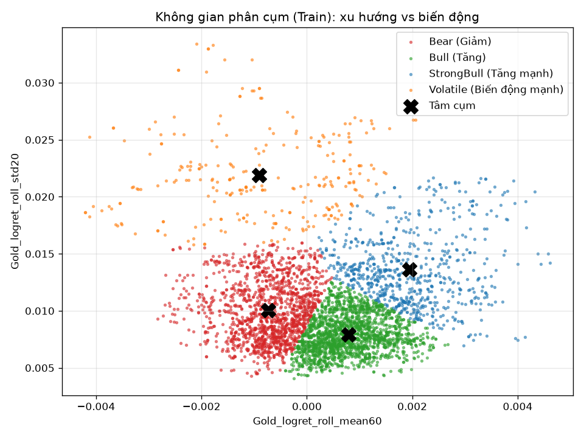
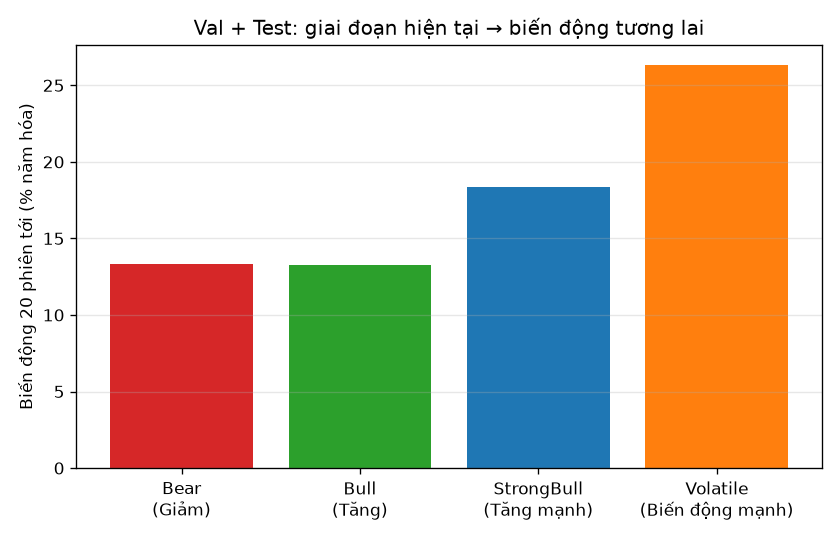
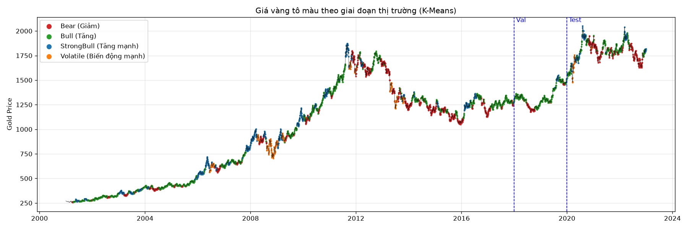
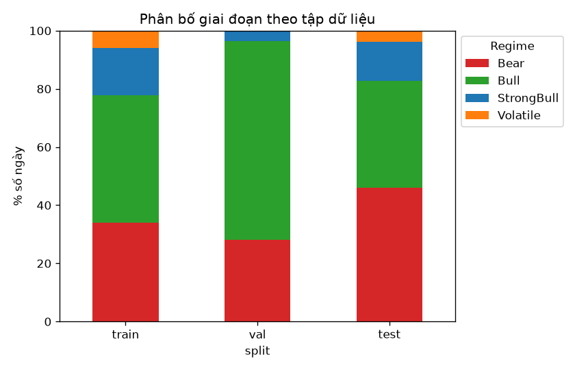
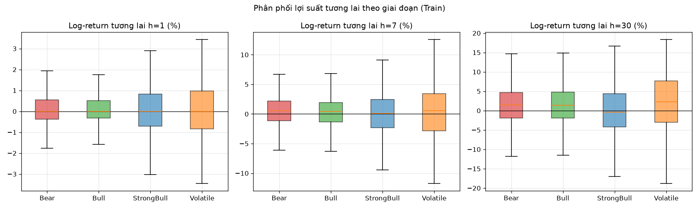
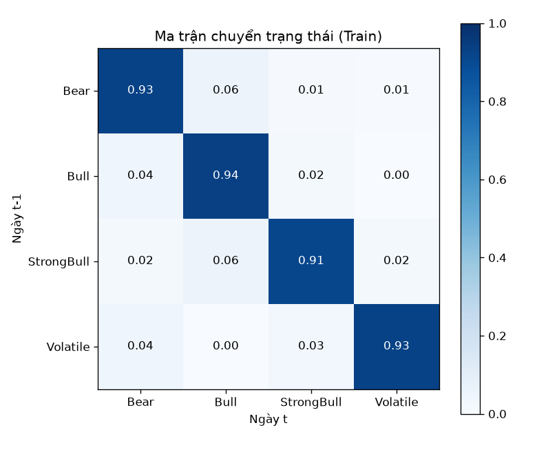

# Kết quả K-Means — Phân lớp giai đoạn thị trường

> File được sinh tự động bởi `python -m source.preprocessing_v3.report_kmeans`. Không sửa tay — chạy lại script sau mỗi lần chạy Stage 2.

## 1. Cấu hình

- Thuật toán: K-Means, k = 4, n_init = 20, random_state = 42
- Feature phân cụm (StandardScaler fit trên Train): `Gold_logret_roll_mean60` (xu hướng 60 phiên), `Gold_logret_roll_std20` (biến động 20 phiên). Cả hai chỉ dùng quá khứ (shift(1)).
- Train: → 2017-12-31 | Val: 2018-01-01 → 2019-12-31 | Test: 2020-01-01 →
- Đặt tên cụm: cụm có biến động cao nhất → **Volatile**; 3 cụm còn lại theo xu hướng tăng dần → **Bear**, **Bull**, **StrongBull**.
- Model: `dataset/processed_v3/models/kmeans.joblib`

## 2. Vì sao chọn cấu hình này

Đã thử nhiều bộ feature với k = 3 và k = 4. Tiêu chí: cụm tách rõ (Silhouette ↑, Davies-Bouldin ↓), giai đoạn đủ bền để dùng được (`avg_run_days` ↑), Val có đủ giai đoạn để đánh giá, và quan trọng nhất là giai đoạn gán trên **Val + Test** (dữ liệu chưa thấy) phân biệt được biến động tương lai (`oos_fwd_vol_ratio` = biến động 20 phiên tới của giai đoạn cao nhất / thấp nhất).

| features | k | silhouette | davies_bouldin | calinski_harabasz | avg_run_days | regimes_in_val | oos_fwd_vol_ratio |
|---|---|---|---|---|---|---|---|
| A. logret ngày + mean20 + std20 (bản cũ) | 3 | 0.228 | 1.404 | 1259.697 | 4.704 | 2 | 1.609 |
| A. logret ngày + mean20 + std20 (bản cũ) | 4 | 0.243 | 1.207 | 1293.256 | 3.560 | 3 | 1.620 |
| B. mean20 + std20 | 3 | 0.356 | 0.975 | 2628.439 | 11.136 | 2 | 1.617 |
| B. mean20 + std20 | 4 | 0.369 | 0.891 | 2761.248 | 9.689 | 2 | 1.863 |
| C. mean60 + std20 (chọn) | 3 | 0.369 | 0.927 | 2705.001 | 16.102 | 2 | 1.717 |
| C. mean60 + std20 (chọn) | 4 | 0.367 | 0.878 | 2940.859 | 13.858 | 3 | 1.982 |
| D. mean60 + std60 | 3 | 0.374 | 0.902 | 3098.114 | 19.345 | 2 | 1.418 |
| D. mean60 + std60 | 4 | 0.353 | 0.897 | 2898.449 | 15.877 | 3 | 1.434 |
| E. gap MA50 + std20 | 3 | 0.366 | 0.939 | 2715.031 | 13.305 | 2 | 1.728 |
| E. gap MA50 + std20 | 4 | 0.344 | 0.908 | 2707.398 | 11.663 | 3 | 1.975 |

So với bản cũ (k = 4): Silhouette 0.243 → **0.367**, Davies-Bouldin 1.207 → **0.878**, độ dài một đợt 3.6 → **13.9 ngày**.

- Bỏ log-return của chính ngày t: feature này làm cụm bị chia theo "hôm nay tăng hay giảm" → nhãn nhiễu, đổi liên tục.
- Xu hướng 60 phiên ổn định hơn 20 phiên; biến động 20 phiên phản ứng nhanh với cú sốc.
- k = 4 thay vì 3: tách được giai đoạn biến động mạnh / khủng hoảng riêng, không trộn lẫn với giai đoạn giảm thông thường.

## 3. Chất lượng phân cụm

Silhouette ↑ (−1…1), Davies-Bouldin ↓, Calinski-Harabasz ↑. Model chỉ fit trên Train; Val/Test dùng nhãn dự đoán.

| split | rows | unlabeled | silhouette | davies_bouldin | calinski_harabasz |
|---|---|---|---|---|---|
| train | 4368 | 61 | 0.3674 | 0.8780 | 2940.8590 |
| val | 522 | 0 | 0.3524 | 0.6616 | 358.0799 |
| test | 778 | 0 | 0.4003 | 0.7886 | 721.3428 |

### Thử nghiệm số cụm k (Train, cùng bộ feature)

| k | inertia | silhouette | davies_bouldin | calinski_harabasz |
|---|---|---|---|---|
| 2 | 5942.1371 | 0.4444 | 1.1785 | 2052.8079 |
| 3 | 3901.0436 | 0.3689 | 0.9270 | 2705.0010 |
| 4 | 2891.1159 | 0.3674 | 0.8780 | 2940.8590 |
| 5 | 2375.1850 | 0.3370 | 0.9098 | 2921.0714 |
| 6 | 2015.1860 | 0.3433 | 0.8615 | 2909.5437 |
| 7 | 1752.6011 | 0.3226 | 0.9010 | 2896.2607 |
| 8 | 1512.8009 | 0.3528 | 0.8327 | 2974.0658 |

- Silhouette tốt nhất tại k = 2; Davies-Bouldin tốt nhất tại k = 8.

## 4. Tâm cụm

`trend_ann_%`: xu hướng quy ra % năm; `vol_ann_%`: biến động quy ra % năm.

| regime | nhãn | cluster_id | Gold_logret_roll_mean60 | Gold_logret_roll_std20 | trend_ann_% | vol_ann_% |
|---|---|---|---|---|---|---|
| Bear | Giảm | 0 | -0.00073 | 0.01005 | -18.45204 | 15.95765 |
| Bull | Tăng | 2 | 0.00079 | 0.00794 | 19.99097 | 12.60263 |
| StrongBull | Tăng mạnh | 1 | 0.00195 | 0.01360 | 49.03960 | 21.59327 |
| Volatile | Biến động mạnh | 3 | -0.00091 | 0.02188 | -22.82601 | 34.74097 |

## 5. Giai đoạn có giúp ích cho dự đoán không? (Val + Test, dữ liệu chưa thấy)

`fwd_vol20_ann_pct`: biến động thực tế 20 phiên tới; `fwd_logret_h*_pct`: log-return trung bình h phiên tới; `up_ratio_h30_pct`: % số ngày giá 30 phiên sau cao hơn hiện tại.

| regime | nhãn | days | fwd_vol20_ann_pct | fwd_logret_h7_pct | fwd_logret_h30_pct | up_ratio_h30_pct |
|---|---|---|---|---|---|---|
| Bear | Giảm | 504 | 13.343 | 0.035 | 0.220 | 48.606 |
| Bull | Tăng | 643 | 13.286 | 0.265 | 0.978 | 53.045 |
| StrongBull | Tăng mạnh | 124 | 18.373 | -0.437 | 0.088 | 36.522 |
| Volatile | Biến động mạnh | 29 | 26.331 | 2.981 | 5.160 | 79.310 |

- Biến động tương lai khác biệt rõ giữa các giai đoạn (cao nhất 26.3% so với thấp nhất 13.3% năm hóa) → giai đoạn mang thông tin về **mức độ rủi ro / độ rộng khoảng tin cậy** của dự đoán.
- Lợi suất trung bình khác nhau giữa các giai đoạn nhưng có số mẫu nhỏ và các cửa sổ h=30 chồng lấn, nên chưa đủ để kết luận về hướng giá. Việc phân lớp có giúp dự đoán giá tốt hơn hay không phải được kiểm chứng bằng so sánh model giữa nhánh `*_base` và `*_kmeans`.

## 6. Thống kê từng giai đoạn theo tập

`mean_logret_%`: log-return ngày trung bình; `ann_vol_%`: biến động năm hóa; `avg_run_days`: độ dài trung bình một đợt liên tiếp; `fwd_logret_h*_%`: log-return trung bình h ngày tới (target).

| split | regime | days | share_% | mean_logret_% | ann_vol_% | avg_run_days | fwd_logret_h1_% | fwd_logret_h7_% | fwd_logret_h30_% |
|---|---|---|---|---|---|---|---|---|---|
| train | Bear | 1480 | 33.883 | 0.031 | 16.373 | 14.095 | 0.041 | 0.337 | 1.078 |
| train | Bull | 1923 | 44.025 | 0.067 | 14.533 | 15.508 | 0.060 | 0.316 | 1.605 |
| train | StrongBull | 704 | 16.117 | -0.073 | 22.454 | 11.355 | -0.053 | -0.104 | -0.319 |
| train | Volatile | 261 | 5.975 | 0.148 | 29.281 | 13.737 | 0.081 | 0.400 | 1.594 |
| val | Bear | 147 | 28.161 | 0.001 | 9.049 | 9.188 | -0.023 | -0.038 | 0.636 |
| val | Bull | 356 | 68.199 | 0.038 | 11.054 | 17.800 | 0.054 | 0.332 | 1.114 |
| val | StrongBull | 19 | 3.640 | 0.074 | 10.395 | 6.333 | -0.049 | 0.085 | -0.551 |
| val | Volatile | 0 | 0.000 |  |  |  |  |  |  |
| test | Bear | 357 | 45.887 | 0.008 | 15.031 | 18.789 | 0.022 | 0.064 | 0.047 |
| test | Bull | 287 | 36.889 | 0.004 | 15.995 | 9.897 | 0.005 | 0.182 | 0.798 |
| test | StrongBull | 105 | 13.496 | 0.023 | 21.031 | 8.750 | -0.049 | -0.536 | 0.214 |
| test | Volatile | 29 | 3.728 | 0.394 | 40.685 | 14.500 | 0.473 | 2.981 | 5.160 |

## 7. Ma trận chuyển trạng thái (Train)

Xác suất giai đoạn ngày t (cột) khi biết giai đoạn ngày t-1 (hàng).

| t-1 \ t | Bear | Bull | StrongBull | Volatile |
|---|---|---|---|---|
| Bear | 0.929 | 0.057 | 0.009 | 0.005 |
| Bull | 0.042 | 0.936 | 0.022 | 0.000 |
| StrongBull | 0.017 | 0.055 | 0.912 | 0.016 |
| Volatile | 0.042 | 0.004 | 0.027 | 0.927 |

## 8. Nhận xét và lưu ý

- Độ bền giai đoạn (xác suất giữ nguyên ngày kế tiếp): Bear = 0.93, Bull = 0.94, StrongBull = 0.91, Volatile = 0.93.
- **Cảnh báo:** không có ngày nào thuộc Volatile trong val → không đánh giá được model ở giai đoạn này trên tập đó; khi so sánh nên báo cáo kết quả theo từng giai đoạn trên Test.
- Số dòng chưa có nhãn (thiếu lịch sử rolling): train = 61, val = 0, test = 0.
- Train (2001–2017) chủ yếu là chu kỳ tăng dài của vàng nên phần lớn cụm có xu hướng dương; không có cụm "đi ngang" riêng vì dữ liệu không tạo ra cụm đó một cách tự nhiên.
